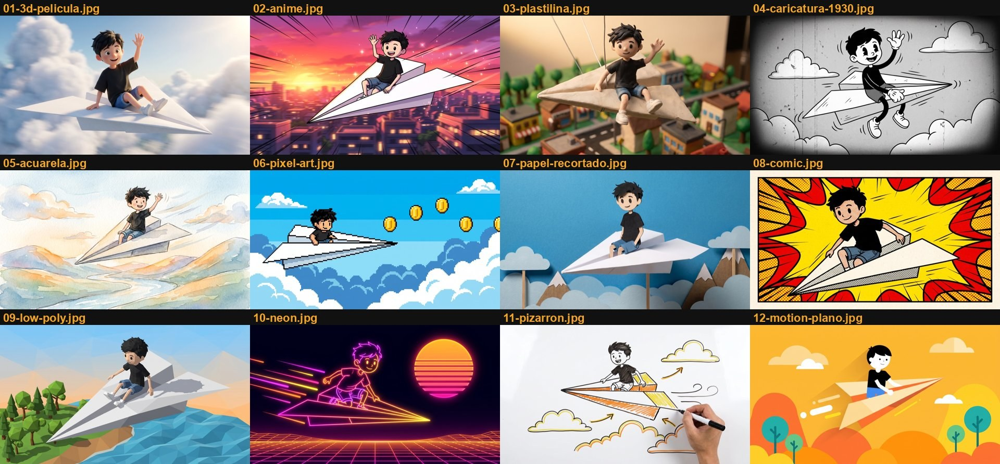

# broll-animado 🎬✨

Skill para **Claude Code** que le mete **B-roll animado** a tus videos donde hablas a cámara: personajes caricatura que actúan lo que vas diciendo, algunos **detrás de ti** (efecto sandwich: la animación pasa entre el fondo y tu silueta), otros al frente o a pantalla completa, con subtítulos palabra por palabra y efectos de sonido que nunca le roban protagonismo a tu voz.

Las imágenes se generan con **Nano Banana**, se animan con **Kling 3.0** (frame de inicio + frame final, para que cada movimiento tenga sentido) a través del **MCP de Higgsfield**, y todo se monta en **HyperFrames**. Sale un MP4 listo para YouTube, Reels o TikTok.

Antes de gastar un solo crédito, el skill te enseña el plan de escenas (qué animación va en cada frase, dónde se coloca y cuánto cuesta) para que lo apruebes.



## Instalación en un prompt

Abre Claude Code y pégale esto:

```text
Clona el skill https://github.com/santmun/broll-animado en ~/.claude/skills/broll-animado e instálalo. Revisa que tenga Node.js 18+, ffmpeg y Python 3 con numpy y Pillow; instala lo que falte. Después dime qué me falta configurar (MCP de Higgsfield y la key de AssemblyAI) y cómo hacerlo.
```

Cuando termine, cierra y vuelve a abrir Claude Code para que cargue el skill.

### Instalación manual

```bash
git clone https://github.com/santmun/broll-animado ~/.claude/skills/broll-animado
```

En Windows la carpeta es `%USERPROFILE%\.claude\skills\broll-animado`.

## Lo que necesitas

| | Para qué | Cómo |
|---|---|---|
| **MCP de Higgsfield** | Generar imágenes (Nano Banana) y animarlas (Kling 3.0) | Conéctalo en Claude Code y ten créditos en tu cuenta de Higgsfield |
| **AssemblyAI** | Transcribir tu voz con tiempos exactos por palabra | Crea una key en assemblyai.com y guárdala (abajo) |
| **Node.js 18+** | Correr HyperFrames con `npx` | https://nodejs.org |
| **ffmpeg** | Cortar, medir audio, quitar el fondo verde | Mac: `brew install ffmpeg` · Windows: `winget install ffmpeg` · Linux: `sudo apt install ffmpeg` |
| **Python 3** con `numpy` y `Pillow` | Scripts del skill | `pip install numpy pillow` |
| EditorBrain (opcional) | Banco de efectos de sonido | Sin él, usa tus propios `.wav` |

Guarda la key de AssemblyAI así:

```bash
mkdir -p ~/.config/broll-animado && echo "ASSEMBLYAI_API_KEY=tu_key" > ~/.config/broll-animado/keys.env
```

## Cómo se usa

Pídelo con tus palabras:

> "Anima el b-roll de este video: ~/Videos/intro.mp4"

> "Hazme las animaciones de mi intro en estilo anime, con mi caricatura como protagonista"

> "B-roll animado para este reel en 9:16, estilo plastilina"

El skill:
1. Transcribe tu video y propone una escena por idea, con su colocación (detrás de ti, al frente, pantalla completa, tarjetas o pantalla dividida) y el costo en créditos. **Tú apruebas.**
2. Hace la hoja de tu personaje (dale una foto o un dibujo tuyo) para que se vea igual en todas las escenas.
3. Genera el frame de inicio y el final de cada escena y los anima con Kling.
4. Quita el fondo verde de cada animación y recorta tu silueta para el efecto sandwich.
5. Monta todo en HyperFrames con subtítulos, cámara con zooms, transiciones y efectos de sonido calibrados contra tu voz.
6. Renderiza, normaliza el audio a −14 LUFS y te enseña cuadros clave para revisar.

## Estilos

| Estilo | Detrás de ti (fondo verde) |
|---|---|
| **intro** — caricatura limpia de línea negra (default) | ✅ probado |
| 3D de película | ⚠️ mejor a pantalla completa |
| anime | ✅ |
| plastilina | ⚠️ |
| caricatura 1930 | ❌ solo pantalla completa |
| acuarela | ❌ solo pantalla completa |
| pixel art | ✅ |
| papel recortado | ⚠️ |
| cómic | ✅ |
| low-poly | ⚠️ |
| neón | ✅ con truco (fondo negro + modo `screen`) |
| pizarrón | ✅ con truco (fondo blanco + modo `multiply`) |
| motion plano | ✅ |

Solo `intro` se probó de punta a punta. Para los demás, las marcas son lo que se espera por cómo se ve cada estilo: haz un clip de prueba antes de un video largo.

## Costos

Precios de Higgsfield en octubre de 2026 (el skill los confirma antes de generar):
- Imagen con Nano Banana 2 Lite: 1 crédito · con Nano Banana Pro 2k: 2 créditos.
- Animación con Kling 3.0 pro: ~1.75 créditos por segundo (un clip de 5 s ≈ 8.75).

Una escena típica = 2 imágenes + 3–5 s de animación.

## Qué trae

```
SKILL.md                 instrucciones para Claude
references/              estilos, plantillas de prompt, composición y los 38 prompts reales de la intro
assets/plantilla/        elenco de ejemplo (protagonista, espectador, roles, robot)
assets/estilos/          un cuadro de muestra por estilo
assets/ejemplo-intro.html  la composición HyperFrames de la intro original
assets/fonts/            Anton, Caveat y DM Sans (licencia SIL OFL, ver OFL-*.txt)
scripts/                 transcribir, quitar verde, subtítulos, efectos de sonido, armar y revisar
```

Hecho con ❤️ por [Horizontes IA](https://horizontesia.com).
